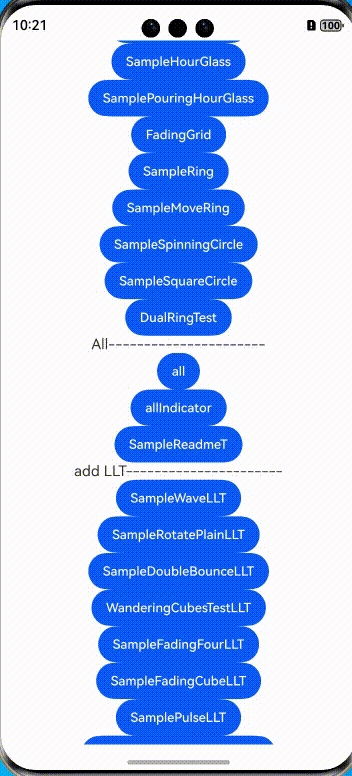
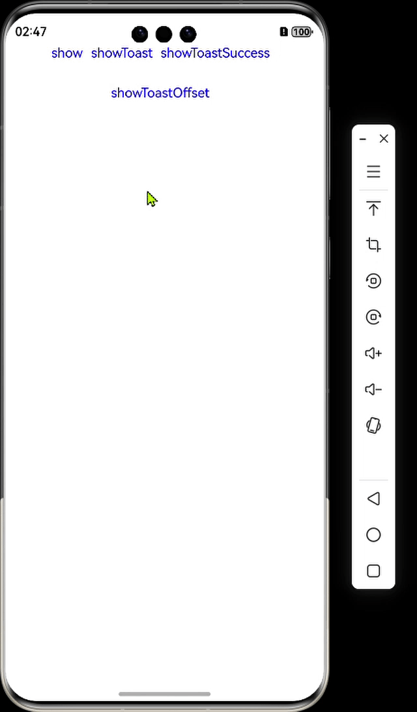

<div align="center">
<h1>easy-loading-cj</h1>
</div>

<p align="center">


</p>

## 介绍

easy-loading-cj 提供了多种 loading/Toast 动画加载效果。

<p align="left">

</p>

## 特性

- 提供 27 种 动画加载效果
- 提供 Toast 功能

### 源码目录

```shell
├─AppScope
├─doc            # API文档和使用手册存放目录                   
├─entry          # 示例代码文件夹                  
├─easyloading    # easyloading 库源目录                  
│  └─src
│      └─main
│          ├─cangjie
│          │  └─src          # easyloading  27种动画效果源码                         
│          └─resources
├─hvigor     # 构建工具目录
├─README.md  # easy-loading-cj 介绍及使用说明
```
## 接口说明

主要类和函数接口说明详见 [API](doc/feature_api.md)

## 使用说明

1. 通过 module 引入
    1. 克隆下载项目
    2. 将 easyloading 模块拷贝到应用项目下
    3. 修改自身应用 entry 下的 oh-package.json5 文件，在 dependencies 字段添加 "easyloading": "file:../easyloading"
    ```json
      {
         "name": "entry",
         "version": "1.0.0",
         "description": "Please describe the basic information.",
         "main": "",
         "author": "",
         "license": "",
        "dependencies": {
            "easyloading": "file:../easyloading"
        }
      }
    ```
    4. 修改自身应用 entry/src/main/cangjie 下的 cjpm.toml 文件，在 [dependencies] 字段下添加 easyloading = {path = "../../../../easyloading/src/main/cangjie", version = "1.0.0"}
    ```toml
        [dependencies]
            [dependencies.easyloading]
                path = "../../../../easyloading/src/main/cangjie"
                version = "1.0.0"
    ```
    5. 在项目中使用 import easyloading.* 引用 easyloading 项目
    ```cangjie
       import easyloading.*
    ```
2. 把 easy-loading-cj 作为三方库依赖引入
    1. 目标工程把 easy-loading-cj 依赖库作为 git submodule 引入

    ```
    >   cd $工程根目录
    >   mkdir third-party
    >   cd third-party
    >   git submodule add "https://gitcode.com/Cangjie-TPC/easy-loading-cj.git"
    ```
    2. 修改自身应用 entry/src/main/cangjie 下的 cjpm.toml 文件，添加依赖
    ```toml
    [dependencies]
        [dependencies.easyloading]
            path = "../../../../third-party/easy-loading-cj/easyloading/src/main/cangjie"
            version = "1.0.0"
    ```
    3. 在项目中使用 easyloading 组件
    ```cangjie
     import easyloading.*
    ```

## 功能示例

详见 `entry`

### 

```cangjie
import ohos.base.*
import ohos.component.*
import ohos.state_manage.*
import ohos.state_macro_manage.*
import ohos.resource_manager.*
import easyloading.*

@Entry
@Component
public class EntryView {
    @State
    var loadingModel: EasyLoadingModel = EasyLoadingModel()  // 测试 fadeGrid 指示器
    @State
    var loadingModel1: EasyLoadingModel = EasyLoadingModel()  // 测试Toast---无图标
    @State
    var loadingModel2: EasyLoadingModel = EasyLoadingModel()  // 测试Toast---有图标
    @State
    var loadingModel3: EasyLoadingModel = EasyLoadingModel() //测试Toast---offset
    @State
    var fadeGridmodel: ?FadingGridModel = Option<FadingGridModel>.None //  fadeGridModel 
    @State
    var toastModel: ?ToastModel = Option<ToastModel>.None   // ToastModel

    protected override func aboutToAppear(): Unit {
        //-----测试指示器-------------
        this.fadeGridmodel = FadingGridModel()
        .setColorArray([Color.BLACK])
        .setSize(50.0)
        .setRowsGap(2.0)
        .setColumnsGap(2.0)

        this.loadingModel
        .setIndicatorType(EasyLoadingIndicatorType.FADINGGRID)
        .setFadingGridModel(this.fadeGridmodel.getOrThrow())
        .setMaskDisplayAnimator(0.5)
        .setScaleAnimator(1.0)
        .setRotateAnimator(360.0)

        //--------------测试Toast---无图标--------

        this.loadingModel1
        .setText("Toast")
        .setWidth(80.0)
        .setHeight(50.0)
        .setBackground(Color.BLACK)
        .setFontColor(Color.WHITE)
        .setIndicatorType(EasyLoadingIndicatorType.TOAST)
        .setMaskDisplayAnimator(0.5)
        .setScaleAnimator(1.0)
        .setRotateAnimator(360.0)

         //--------------测试Toast---有图标--------
        this.toastModel = ToastModel()
        .setWidth(50.0)
        .setHeight(50.0)
        .setIcon(@r(app.media.dui))

        this.loadingModel2
        .setText("Great Success!")
        .setWidth(140.0)
        .setHeight(110.0)
        .setBackground(Color.BLACK)
        .setFontColor(Color.WHITE)
        .setIndicatorType(EasyLoadingIndicatorType.TOAST)
        .setToastModel(this.toastModel.getOrThrow())
        .setMaskDisplayAnimator(0.5)
        .setScaleAnimator(1.0)
        .setRotateAnimator(360.0)

        //--------------测试Toast---offset--------
        this.loadingModel3
        .setText("Toast")
        .setWidth(80.0)
        .setHeight(50.0)
        .setBackground(Color.BLACK)
        .setFontColor(Color.WHITE)
        .setIndicatorType(EasyLoadingIndicatorType.TOAST)
        .setMaskDisplayAnimator(0.5)
        .setIsOffset(true)
        .setOffsetDirection(Alignment.Top)
        .setOffsetY(70.0)

    }
    func build() {
         Column {
            Column() {
                Column() {
                    Row{
                        Text("show").fontColor(Color.BLUE).margin(right:10)
                        .onClick ({ event =>
                            this.loadingModel = this.loadingModel.show()
                        })

                        Text("showToast").fontColor(Color.BLUE).margin(right:10)
                        .onClick ({ event =>
                            this.loadingModel1 = this.loadingModel1.show()
                        })

                        Text("showToastSuccess").fontColor(Color.BLUE).margin(right:10)
                        .onClick ({ event =>
                            this.loadingModel2 = this.loadingModel2.show()
                        })

                    }.width(100.percent)
                    .justifyContent(FlexAlign.Center)
                    .margin(bottom: 30)
                }
                Column() {
                        Row{
                            Text("showToastOffset").fontColor(Color.BLUE).margin(right:10)
                            .onClick ({ event =>
                                this.loadingModel3 = this.loadingModel3.show()
                            })

                        }.width(100.percent)
                        .justifyContent(FlexAlign.Center)
                        .margin(bottom: 30)
                    }
            }
            Column() {
                EasyLoading(model: this.loadingModel)
                EasyLoading(model: this.loadingModel1)
                EasyLoading(model: this.loadingModel2)
                EasyLoading(model: this.loadingModel3)
            }.position(x: 0.vp,y: 0.vp).zIndex(100)
        }.width(100.percent).height(100.percent)
    }
}
```
<p align="left">

</p>

## 约束与限制

在下述版本验证通过：

| 编号 | 依赖构建工具                                       | 版本号       |
|----|----------------------------------------------|-----------|
| 1  | **DevEco Studio**                            | 6.1.1.280 |
| 2  | **cjc**                                      | v1.1.3    |
| 3  | **DevEco Studio-Cangjie Plugin 6.1.1 Beta1** | 6.1.1.280 |
| 4  | **compatibility-sdk-6.1.1.280**              | 6.1.1.280 |
    
    1.PouringHourGlass PumpingHeart两个加载动画没有填充效果

## 开源协议

本项目基于 [MIT License](./LICENSE)，请自由的享受和参与开源。

## 参与贡献

欢迎给我们提交 PR，欢迎给我们提交 Issue，欢迎参与任何形式的贡献。
